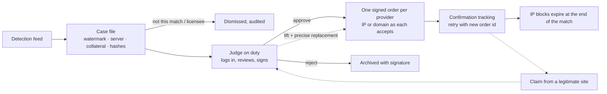
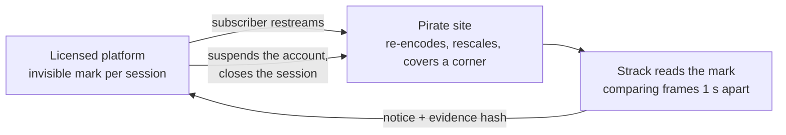

# Strack

**Federal platform for live blocking orders against pirate football streams.** MVP for the
Hackathon Argentina Space 2026 (track *Datos y Streaming*, challenge
[`qualydata-org/desafio-futbol`](https://github.com/qualydata-org/desafio-futbol)), written in Rust.

During a match, Strack turns every detected stream into a case file with verifiable evidence, sends
it to the judge on duty, signs the judge's decision, delivers the order to every internet provider in
the block type each one accepts, follows their confirmation (retrying failures), lets IP blocks expire
when the match ends, handles claims from legitimate sites and keeps a hash-chained audit log plus a
public transparency registry.

> All data is fictitious and nothing real is blocked: the platform only talks to the challenge
> simulator. This is not legal advice.



## How it meets the challenge

| Requirement | What Strack does |
|---|---|
| Watermark proof | The extracted watermark must match a valid prefix of **this** match (`prefix` or `prefix-…`, longest match wins). A licensee prefix is lawful only on that licensee's authorized domains; the official signal or a licensee's signal anywhere else is pirate. Other events and missing watermarks are dismissed (audited, never sent to the judge). |
| Stream server | The order targets the server that delivers the video (`host_stream`, `ip_servidor`, ASN), not the player page. Passive DNS confirms the host on that IP and the ASN. |
| Collateral rule | Block by **IP only** when everything passive DNS saw on that IP belongs to the same pirate site and the network is not a CDN or shared hosting. Otherwise block the **stream host by domain**. Unknown IPs (no passive DNS) are treated as shared. |
| Integrity | SHA-256 of the raw detection (canonical JSON), of the decoded capture, and of the whole case file. The case hash is written to the hash-chained audit log when the case opens, so any later change is detectable (`strack verify`). |
| Judge login and duty | Each judge has a user and password (Argon2id). Their demo signing key is stored **sealed with their own password** (Argon2id + ChaCha20-Poly1305) and is only unsealed into memory at login: the platform cannot sign for a judge who has not logged in. A judge signs only on duty, stopping 0.1 match minutes before the shift ends; pending cases and claims are reassigned to the incoming judge (audited). |
| Signed decision | Approvals and rejections carry an HMAC over the case hash, the measure, the judge and the minute. Each provider order carries the simulator's demo signature. |
| Dispatch | One order per provider, in parallel, in the type it accepts (domain-only providers get the stream host). Transport errors retry with the same id (a `409` then means delivered); provider failures (`fallida`) retry with a **new order id**, signed by the approving judge while on duty, or by the incoming judge from their inbox. |
| Expiry | IP blocks expire at `ceil(fin_min)`; domain blocks too by default (`--domain-extra-min` to extend). |
| Audit log | Every step (detection, case, notification, login, decision, signature, send, apply, failure, retry, expiry, claim, lift, reassignment) is an entry in `var/audit.jsonl`, chained by SHA-256. |
| Transparency (extra) | Public page and `/api/registry`: what was blocked, when, by which judge and court, until when, and lifts. Shows the audit chain head. |
| Claims (extra) | Verifies whether the claimant sits behind one of our active blocks (any provider), whether it is the pirate site itself or a licensee. On approval the judge's signature lifts every order reaching the claimant and replaces IP blocks with a domain block on the pirate host. |
| Promotion (extra) | Where the link was promoted (X, Discord, Telegram) is part of the case file. |
| Judge UI (extra) | Mobile-friendly panel with a live inbox, title badge, screen-reader announcements and opt-in browser notifications. |
| Administration (extra) | Users (judges, operators, admins: create, edit, password, disable, close sessions, delete), the registry of licensed platforms, "Mi cuenta", and reference pages for providers, courts and shifts, and the audit log with filters. Every change is audited without secrets. |
| Several matches at once (extra) | `--simulator` takes one address per match (repeat it or separate with commas). Each match runs its own loops, clock, state and audit chain; the judge's inbox, the transparency registry and the operations page cover every match, with a switcher where a page shows one. Case ids never repeat across matches (match *n* numbers from `(n − 1) × 100000`). |
| Loading streams (extra) | Prosecutors and rights holders load one or many pirate streams in **Cargar sitios** (`/ops/intake`): one per line (stream address, then the watermark their tool read, the player page and the server IP in any order), CSV, a file, or the feed's JSON. Monitoring tools use `POST /api/detections` with a bearer token (`--intake-token`). Strack resolves the server through passive DNS when no IP is given, builds the same evidence as for the feed (each detection records who loaded it) and sends new cases to the judge on duty. |
| Leak tracing (extra, our own) | Licensed platforms hide a per-session mark (an invisible watermark plus a JPEG comment) in each subscriber's stream. Strack reads it from the pirate copy, identifies the leaking account and asks the platform to suspend it: the stream is cut at the source, with no IP or domain block. See [Leak tracing](#leak-tracing). |

## Practice match results

Official evaluator (`evaluacion/verificar.py`) on the practice scenario, simulator at 30×, both demo
judges approving through the web forms:

| Metric | Result |
|---|---|
| Pirate phases blocked | 7 of 7 |
| First confirmed block after the detection | 0.5–0.8 match minutes |
| Customers covered per phase | 100 % |
| Average residual visibility | 3.1 % |
| Collateral damage / false positives | 0 / 0 (licensee and other-event streams dismissed) |
| IP blocks active after the match | 0 |
| Orders rejected by providers / signed off duty | 0 / 0 |
| Provider failures retried with a new order id | 1 of 1 (re-received 0.12 min later) |
| Audit chain | 177 entries, verified |

With a human judge the time to block adds the judge's review time.

## Quick start

**Fastest:** `powershell -ExecutionPolicy Bypass -File scripts/demo.ps1 -Standalone` needs nothing else
(a configured match on the wall clock, four provider receivers; load `docs/demo-streams.csv` in
Cargar sitios). With the challenge repository in `var/challenge/`, run
`powershell -ExecutionPolicy Bypass -File scripts/demo.ps1` (Windows). It builds Strack and starts the
simulator, the demo licensed platform, the demo pirate and Strack with fresh state, and prints the
addresses and accounts; [`docs/demo.md`](docs/demo.md) is a 3-minute walkthrough.
`scripts/demo-stop.ps1` stops everything.

**Live, nothing scripted:** `scripts/demo.ps1 -Live -Video <a local match recording> -VideoStart 600`
broadcasts the recording from the licensed platform (read from disk, never copied into the repository),
restreams it from the pirate at `127.0.0.2:8200` and opens a browser window of a subscriber of the
Aurora provider, whose network edge (`strack provider --gateway`) enforces the orders. Load the pirate's
page in Cargar sitios: Strack reads the platform's invisible mark from the stream and opens the case
with that evidence; when the judge signs, the subscriber's stream stops and the block page appears.
The stream reader only opens public internet addresses; `serve --allow-private-streams` lifts that
for local demos (the demo script passes it).

By hand. Requirements: Rust 1.85+ and Python 3.9+ (for the challenge simulator).

```bash
# 1. The challenge simulator (unchanged), in its own folder
git clone https://github.com/qualydata-org/desafio-futbol
cd desafio-futbol
python -X utf8 simulador/servidor.py --escenario datos/escenario_practica.json --acelerar 6

# 2. Strack, in another terminal
cd strack
cargo run --release -- serve --simulator http://localhost:8080
# open http://127.0.0.1:3000
```

`-X utf8` avoids a `UnicodeEncodeError` the simulator hits on Windows consoles.

### Demo accounts

Already enrolled in `config/accounts.json` (hashes and sealed keys only; the passwords below are demo
credentials allowed by the challenge rules):

| User | Password | Role | Shift (match minutes) |
|---|---|---|---|
| `laura` | `laura-demo-2026` | Judge, Dra. Laura Ficticia (jg-centro-3) | −60 to 50 |
| `martin` | `martin-demo-2026` | Judge, Dr. Martín Ejemplo (jg-norte-1) | 50 to 240 |
| `fiscalia` | `fiscalia-demo-2026` | Operator (operations board) | — |
| `admin` | `admin-demo-2026` | Administration (users and platforms) | — |
| `tvf` | `tvf-demo-2026` | Platform: TV Ficticia Play's portal (`/platform`) | — |

Getting in without an account or without the password: **Pedir acceso** (`/access`) leaves a request
that an admin approves (creating the account) or rejects in `/admin/users`, and **¿Olvidaste tu
contraseña?** (`/recover`) tells the admins. Nothing is mailed: the admin generates a one-time link
(30 minutes, kept hashed in memory) on the user's page and hands it over through a channel they trust;
with it the person chooses their own password (a judge also enters their signing key again, which is
sealed under the new password). An account created without a password gets such a link too.

To re-enroll (for example with other passwords) you need the challenge's `datos/juzgados.json`, which
holds the demo signing keys:

```bash
STRACK_PASSWORD='a-new-password' cargo run -- enroll --username laura --role judge \
  --judge-id jueza-laura-ficticia --courts ../desafio-futbol/datos/juzgados.json
```

### Match-day runbook

1. Start Strack against the simulator address assigned to the team:
   `strack serve --simulator http://<assigned-host>:<port> --listen 0.0.0.0:3000`.
2. Both judges log in **before kick-off** (each on their own device; the panel works on a phone) and
   enable browser notifications. The outgoing judge's pending work moves to the incoming judge at
   minute 50 automatically.
3. Keep `/ops` open for the confirmation board.
4. After the match plus the 5-minute grace period, export the delivery files and verify them:

```bash
strack export --state-dir var --out entrega
strack verify --audit entrega/registro-auditoria.jsonl --case entrega/expediente-<ID>.json
```

If the platform has to restart mid-match, start it with `--resume` to continue from `var/`.

## Leak tracing

Blocking an IP or a domain fights the symptom: the pirate moves to another server. Most pirate streams
are a legitimate subscription restreamed, so Strack can also go after the **source account**.



- **The mark.** 120 bits per session: a magic byte, the platform's 16-bit code (from the SHA-256 of
  its id), the subscriber number (`c-NNNNN`), a random 32-bit session id issued by the platform and a
  CRC-32 (Hamming distance 6, so correcting a few unreliable bits can never turn one mark into
  another). Nobody can frame another subscriber: the platform only accepts a session it issued, to
  that subscriber, and the session id appears only in that subscriber's stream.
- **Invisible watermark** (`leak::watermark`, default). A public pseudo-random layout spreads every bit
  over about 16 of the 1,980 16-pixel blocks of the frame. The platform raises or lowers brightness
  around each block centre by at most 2 levels of 255, as a smooth surface (no block edges), and the
  pattern fades in and out with a 2-second period. At the worst moment no pixel changes more than
  2 levels and PSNR stays above 40 dB: nothing to see. Detection compares frames one second apart, so
  everything static cancels out and only the pattern remains; outlier blocks (moving players) are
  dropped, the magic byte fixes the sign and the CRC rejects noise. On moving footage a lock-in
  accumulator correlates frame pairs half a second apart with the known 2-second rhythm (crowds,
  pans and close-ups average out) and Chase decoding fixes the last few unreliable bits; only marks
  of platforms in `config/platforms.json` are accepted then.
  The same text (`STK2|<platform>|<client>|<session>`) also goes in each frame's JPEG comment, and
  `strack demo platform --mark visible` draws it as a QR code to show what the mark carries.
- **Reading it.** `Rastreo de origen` (`/ops/traces`) reads the pirate's stream in any common format:
  MJPEG and JPEG natively, and HLS (`.m3u8`), DASH (`.mpd`), MP4, MPEG-TS, WebM, FLV and RTMP through
  ffmpeg (`leak::source`, `--ffmpeg`), which hands the scanner 8 JPEG frames per second at the
  stream's own pace. ffmpeg gets only network protocols (`-protocol_whitelist`), so an address or a
  playlist that points at `file://` is refused. People can also paste the **pirate page** instead of
  the stream: Strack reads its HTML (never runs it, 2 MB and 10 s at most), takes the streams from
  `<video>`, `<source>`, `<embed>`, `<object>`, MJPEG `` and stream addresses in its scripts,
  follows embedded players (`<iframe>`) one level, and starts one trace per stream found (up to 5),
  recording the page (`leak::discover`). The same works from the platform portal, Cargar sitios with
  "Rastrear" ticked, and `strack trace <page>`. The JPEG comment
  is lost as soon as the pirate re-encodes; the watermark survives the demo pirate's 80 % rescale,
  JPEG quality 55, a logo over a corner and a banner over the broadcaster's bug (tested in
  `leak::watermark` at every phase of the cycle, with no false positives on an unmarked stream).
- **Acting on it.** Strack stores the frame, and the reference frame the watermark was read against,
  as evidence (SHA-256), sends a notice to the platform's
  API (`POST /api/notices`, bearer token from `config/platforms.json`, retried on network errors) and
  confirms the cut when the mark disappears from the pirate stream. Every step is in the audit log;
  a trace can be linked to a case and is then part of its case file.
- **Privacy.** The client id is the platform's pseudonymous subscriber number; Strack never gets
  personal data, and traces are visible only to logged-in users (not in the public registry).

### Demo (three terminals, or run each in the background)

```bash
strack demo platform   # licensed platform "TV Ficticia Play" on http://127.0.0.1:8100
strack demo pirate     # pirate site on http://127.0.0.1:8200, holds accounts c-00042, c-00043, c-00044 (demo password)
strack serve           # Strack on http://127.0.0.1:3000 (the simulator is optional for this demo)
```

Log in to Strack, open **Rastreo de origen** and trace `http://127.0.0.1:8200/stream.mjpg`. Practice
run with the invisible watermark: each account was identified about a second after it went on air
(the time to have two frames to compare) and suspended 5 to 40 ms later; the pirate switched accounts
after 6 s of "no signal" and each new account fell the same way, until it ran out of accounts. `strack trace <url>` prints the marks of a stream without notifying anyone, and
**Reiniciar la demo** on the staff console reactivates the accounts.

The platform has real accounts. Subscribers **sign up** (`/signup`: name, email, plan, password), **sign
in** with their email or subscriber number (`/login`), **recover** the account with a one-time link
(`/recover`, 30 minutes, works once, signs out every session) and manage it in **Mi cuenta**
(`/account`: edit the profile, change the password, delete the account). Only the subscriber who opened
a session (or the staff) can watch it; scripted clients sign in through `POST /api/sessions` with
`client_id` (or `email`) and `password` and get a stream address with its own key. The staff console
(`/admin`, user `personal`, password `personal-demo-2026`) has the full subscriber CRUD: create (with
a password, or without one so the subscriber chooses it from a welcome link), search, a detail page
per subscriber, edit, suspend and reactivate, send a password link, delete with confirmation. The demo
sends no email: the platform's mails (recovery and welcome links) land in the **demo mailbox**
(`/mailbox`). Accounts are saved in `var/demo-platform/subscribers.json` (`--data`); a missing file is
created with `--subscribers` demo accounts `abonado41@tvficticia.test`, `abonado42@...` (`c-00041`,
`c-00042`, ...), all with the password `abonado-demo-2026`.

The video is a synthetic match drawn by the platform itself (with static grass texture, as real
footage has), so no copyrighted footage is involved.

### For licensed platforms (the clients of the service)

- **Portal.** An admin registers the platform in `/admin/platforms` and creates an account with the
  role **Plataforma** for it. That account sees only its portal (`/platform`): the accounts of its own
  that showed up in pirate copies, the notices Strack sent and how the platform answered, a form to
  trace a pirate stream, and its integration settings (notice API address, token). Every internal
  page (`/ops`, `/judge`, `/admin`, case files, the audit log) answers 403 to it.
- **Marking.** `strack mark --platform <id> --client <n> --session <8 hex> --input <video> --output
  <video>` hides one viewing session's mark in a video (ffmpeg decodes, the watermark is added to every
  frame, H.264 out, sound kept as AAC) and prints the mark. On a 15 s clip of real 720p footage it runs
  at about 4x real time, and `strack trace <file>` read the mark back after the copy was downscaled to
  480p and re-encoded at CRF 28. For a live signal, run it per session between the encoder and the CDN,
  or call `leak::watermark::Pattern` from the platform's own encoder.
- **Notices.** Strack sends `POST <api_url>/api/notices` with `Authorization: Bearer <token>` and
  `{notice_id, mark, pirate_url, frame_sha256, detected_at, case_id, issuer}`; the platform checks the
  session is its own and that subscriber's, suspends the account and answers `200 {status:
  "suspended" | "already_suspended", client_id, session_id, sessions_closed, at}`, or 4xx
  `{error: "unknown_session"}` (not retried). 5xx or no answer is retried. The portal's
  **Guía de integración** (`/platform/guide`) says the same for the platform's engineers.
- **Automatic tracing.** **Cargar sitios** (and `POST /api/detections?rastrear=1`) can also start a
  trace for each loaded stream, linked to its case, so a stream that carries a platform's mark gets
  its source account cut while the judge decides on the block.

### Real footage

`strack demo platform --video <file.mp4> [--audio <file>] [--video-start <seconds>] [--loop]` broadcasts
a local video instead of the synthetic match. `--audio` takes the sound from another copy of the same
video with the same timeline (for example a lower-resolution download that has the audio track when
the high-resolution one has none). ffmpeg (an external tool, only needed for this option) decodes it in
real time at the file's own resolution and frame rate (no scaling, every frame), and each subscriber
gets every frame with their invisible mark: `/watch/<session>` plays it in a plain `<video>` element
(H.264, CRF 18, a keyframe per second, with the file's sound when it has any), `/live/<session>.mjpg`
serves it to machines. Like live TV the broadcast goes on air with its first viewer and follows the
wall clock, so it lasts as long as the file; a viewer who arrives late joins at the current minute.
When the file ends every session shows a closing card and the stream ends (`--loop` starts again
instead). ffmpeg only runs while somebody watches. The file is read from disk and is not part of the
repository. Do not publish footage you have no rights to: the demo video for the jury should use the
synthetic match or licensed material.

Measured on a full professional match broadcast (720p), through the demo pirate (80 % size, JPEG 55,
corner logo, banner), reading the pirate's stream with `strack trace`: the subscriber was identified
in all 7 segments tried, in 0.8–4 s in 6 of them (open play, wide shots) and in 15 s in the hardest
one (close-ups, crowd shots and cuts every second, where 60–80 % of the picture changes between frames).

### Robustness

Measured with `cargo test --release -- --ignored --nocapture robustness` (10 s of simulated video per
attack, scanned 4 times per second):

| Pirate transformation | Result |
|---|---|
| Demo pirate (80 % size, corner logo, banner, JPEG 55) | Found after 0.75 s of video |
| 50 % size, JPEG 50 · 33 % size (320×180), JPEG 30 · JPEG quality 15 | Found after 0.75–1 s |
| Blur (σ 2) · random noise ±12 per frame · brightness/contrast · gamma · grayscale | Found after 0.75 s |
| 2 or 1 frames per second | Found after 1 s |
| Encoder that skips blocks with small changes (H.264-like, threshold 1.5 / 3 levels) | Found after 1 s / 5.75 s |
| Crop of 2 %, 8 % or 12 % of each border · crop 5 % left and 7 % bottom | Found after 0.75 s |
| Horizontal mirror · mirror + crop 4 % + 50 % size + JPEG 40 | Found after 0.75 s |
| Collusion: average of two subscribers' streams | **Not found**, and nobody is wrongly named |

When the whole frame does not read, the detector searches for the crop (up to 10 % per side, 1 %
steps) and mirror the pirate applied: each candidate is scored by how coherent its bits are, using a
summed-area table of the frame difference, and the view that reads the mark is kept. The test asserts
that the detector never names the wrong subscriber. Known gaps of this MVP: no rotation, perspective
or camcording, no anti-collusion code, a public layout, and no test against a real H.264/HLS
pipeline. Commercial forensic watermarking covers those; the circuit (extract, verify with the
platform, suspend, confirm) stays the same.

## Running for real, without the simulator

The challenge simulator stands in for the match clock, the courts, the providers and the detection
feed. In production each of those is its own system, and Strack follows a match from a config file
instead (`--config`, repeatable, and it can be mixed with `--simulator` matches):

```bash
strack serve --config config/match.example.json --intake-token "$TOKEN"
```

- **The match** (`partido`): teams, kick-off (`inicio_iso`), length, the valid watermark prefixes and
  the licensees with their authorized domains. The clock is the wall clock from kick-off.
- **Courts and duty shifts** (`juzgados`): who is on duty, in minutes from kick-off.
- **Providers** (`proveedores`): the registry, each with the address of its order API (`api_url`).
  Orders, their status and lifts go there in the same wire format the simulator speaks
  (`POST {api_url}/proveedores/{id}/ordenes`, `GET .../ordenes`, `POST .../ordenes/{orden_id}/levantar`).
- **Detections** come from monitoring tools through `POST /api/detections` and from people through
  **Cargar sitios**. An optional passive DNS service (`dns_pasivo`, answering `/dns-pasivo?ip=` and
  `?dominio=`) confirms servers and finds sites sharing an IP; without it every IP counts as shared,
  so blocks go by domain and no legitimate site is caught.

`strack provider --id <id> --kickoff <time> [--accepts ip,dominio] [--hook <command>]` is a reference
receiver a provider can run: it keeps the orders on disk, reports their status, lifts them on request
and lets them expire at `vence_min`, and runs `--hook` for every apply, lift and expiry
(`STRACK_ACTION`, `STRACK_KIND`, `STRACK_TARGET`, `STRACK_ORDER_ID`) to push the block to its DNS
resolver or firewall. Tested end to end with four receivers and no simulator: a stream loaded through
the API, a judge's approval, four orders applied (each hook ran), and every block expired at the end of
the match with the audit chain valid.

## Command line

| Command | Purpose |
|---|---|
| `strack serve` | Run the platform. Flags: `--config` (a match without the simulator, repeatable), `--simulator` (one per match; the first match keeps its state in `--state-dir`, match *n* in `<state-dir>/match-<n>/`), `--listen`, `--accounts`, `--state-dir`, `--resume`, `--poll-ms` (default 1000), `--domain-extra-min` (0), `--shift-margin-min` (0.1), `--secure-cookies`, `--intake-token` (env `STRACK_INTAKE_TOKEN`; enables `POST /api/detections`), `--ffmpeg` (env `STRACK_FFMPEG`; reads non-MJPEG pirate streams). |
| `strack enroll` | Create or update an account (`--role judge\|operator\|admin`); judges get their key sealed with their password. Accounts can also be managed from `/admin/users`. |
| `strack verify` | Check the audit chain and, with `--case`, an exported case file against it. |
| `strack export` | Write `expediente-<ID>.json`, `registro-auditoria.jsonl` and `registro-transparencia.json` (for match *n* > 1 pass `--state-dir <state-dir>/match-<n>`). |
| `strack trace <url or file>` | Print the session marks read from a stream (MJPEG, JPEG, HLS, DASH, MP4, TS, WebM, RTMP), a pirate page (its video is found first) or a local video file, and when (`--seconds`, default 20; `--platforms`; `--ffmpeg`). Sends no notice. |
| `strack provider` | Reference order receiver for a provider (`--id`, `--listen 127.0.0.1:9101`, `--kickoff`, `--accepts`, `--data`, `--hook`). |
| `strack mark` | Hide one session's mark in a video file (`--platform`, `--client`, `--session` or a random one, `--input`, `--output`, `--strength`, `--ffmpeg`); prints the mark. |
| `strack demo platform` | Demo licensed platform (`--listen 127.0.0.1:8100`, `--data`, `--subscribers`, `--staff-user`, `--staff-password`, `--video`, `--audio`, `--video-start`, `--loop`, `--ffmpeg`, `--mark invisible\|visible`, `--mark-strength`, `--fps`, `--notice-token`). |
| `strack demo pirate` | Demo pirate restream (`--listen 127.0.0.1:8200`, `--platform`, `--accounts`, `--password`, `--cover`, `--scale`, `--quality`). |

`strack serve` also takes `--platforms` (default `config/platforms.json`), the platforms that accept
leak notices.

## Web interface

| Path | Who | What |
|---|---|---|
| `/` | Public | Transparency registry (live) and audit chain head. |
| `/login` | Judges, operators | Login. |
| `/access`, `/recover` | Public | Ask for an account, or tell the admins you lost your password. |
| `/password/{token}` | Holder of a one-time link | Choose the password (judges also enter their signing key). |
| `/judge` | Judges | Live inbox across every match: cases, claims and retries awaiting signature; duty status per match. |
| `/judge/cases/{id}` | Assigned judge | Evidence, plain-language request, approve (IP as recommended or domain only) or reject with reason. |
| `/judge/claims/{id}` | Assigned judge | Claim verification, affected orders, accept (lift + replace) or reject. |
| `/ops` | Logged in | Live matches, and for the chosen one (`?partido=<n>`) its cases, per-provider confirmation matrix and claims. |
| `/ops/intake` | Operators, admins | Load one or many pirate streams (text, CSV, file or JSON) into a match. |
| `/ops/traces` | Logged in | Leak tracing: start a trace, follow identified accounts, notices and evidence frames. |
| `/platform`, `/platform/guide` | Platform accounts | A licensed platform's portal: its leaked accounts and notices, trace a pirate stream, integration settings and guide. |
| `/ops/providers`, `/ops/courts`, `/ops/audit` | Logged in | Provider registry, courts with who is on duty now, audit log with filters and pages. |
| `/account` | Logged in | Own profile and password change (a judge's key is sealed again with the new password). |
| `/admin/users`, `/admin/platforms` | Admin | User accounts and the registry of licensed platforms (create in a dialog, edit, delete with confirmation), pending access and recovery requests, one-time password links. |
| `/api/registry`, `/api/clock`, `/api/audit/head` | Public | JSON (`?partido=<n>` picks the match for the clock and the chain head). |
| `/api/cases/{id}`, `/api/audit` | Logged in | Case file export, full audit log of a match (`?partido=<n>`). |
| `POST /api/detections` | Monitoring tools (`Authorization: Bearer <token>`) | Load detections in the feed's format into a match (`?partido=<n>`); off without `--intake-token`. |

## Project layout

```
src/
  cli.rs        serve / enroll / verify / export
  simulator.rs  simulator client and wire types
  evidence.rs   watermark, collateral, server and capture evidence, per-provider plan
  workflow.rs   cases, signatures, orders, retries, claims, shift handover, registry
  engine.rs     poller and dispatcher loops, one set per match, and the shared ingest path
  intake.rs     streams loaded by hand or through the API: parsing and the detection they become
  standalone.rs matches followed without the simulator (config file, wall clock, providers' APIs)
  provider.rs   `strack provider`: reference order receiver for a provider
  judges.rs     accounts, sealed keys, sessions, shifts
  audit.rs      hash-chained audit log
  export.rs     delivery files and verification
  leak/         session mark, QR/JPEG/MJPEG handling, synthetic broadcast, traces and notices,
                `strack mark` (marker.rs)
  access.rs     access requests, recovery requests and one-time password links
  demo/         demo licensed platform (accounts, subscriber site, staff console) and pirate restream
  web/          axum + maud UI (labels.rs holds all Spanish UI copy)
assets/         CSS and JS (embedded in the binary)
config/         demo accounts (hashes and sealed keys) and the platforms that accept leak notices
entrega/        delivery folder: regulatory proposal, exported case file and audit log
scripts/        demo.ps1 / demo-stop.ps1: the whole demo with one command
docs/           demo.md: the 3-minute walkthrough
```

## Assumptions

- The judge on duty is the competent judge (both demo courts share the jurisdiction); shifts come from
  the simulator (`GET /juzgados`).
- One case per stream server (`host` + `IP`). Later detections of the same server are attached to the
  case as sightings with their own hashes; a server change opens a new case linked to the earlier ones.
- "Same site" uses the registrable domain (label before the public suffix). A production build would use
  the Public Suffix List.
- A retry or replacement of an approved order is the same judicial decision executed again; it is
  signed automatically only by the approving judge while on duty with a live session.
- Domain blocks expire with the match by default; a longer term needs `--domain-extra-min` (and, in the
  proposal, a new order).
- Claims are matched against our active orders through passive DNS (IP blocks) or by name (domain
  blocks).

## Pre-existing code and libraries

Everything in this repository was written during the hackathon. It uses these open-source crates:
`axum`, `tokio`, `reqwest` (rustls), `maud`, `serde`/`serde_json`, `sha2`, `hmac`, `hex`, `base64`,
`argon2`, `chacha20poly1305`, `zeroize`, `subtle`, `rand`, `chrono`, `clap`, `anyhow`, `tracing`,
`tracing-subscriber`, and for leak tracing `image` (JPEG), `qrcode`, `rqrr` (QR decoding), `font8x8`,
`bytes`, `futures-util`, `tokio-stream`. The interface uses the IBM Plex fonts (SIL Open Font License,
`assets/fonts/OFL.txt`), served by Strack itself. The challenge simulator, evaluator and data are used unchanged
from `qualydata-org/desafio-futbol`. ffmpeg is an optional external tool, used only by
`strack demo platform --video`.

## Security notes

- No signing key is stored in clear; sessions hold the unsealed key in memory only (zeroized on drop).
- Platform accounts (clients) are fenced to `/platform`, `/account` and public pages by a router
  middleware (`client_scope`), not by each handler. From the portal a platform can only point its
  notice API at a public address (every resolved IP outside loopback, private, link-local and CGNAT
  ranges, IPv4 hidden in IPv6 included); internal addresses are set by an admin. The check runs again
  when each notice is sent and the connection is pinned to the addresses just checked, so a DNS change
  cannot move it inside the network; notices never follow redirects.
- A failed sign-in names the account only when it exists: whatever was typed in the username box
  (sometimes a password) never reaches the audit log.
- Sessions: random 256-bit token, `HttpOnly`, `SameSite=Strict` cookie (`--secure-cookies` behind
  HTTPS), CSRF token on every form, login lockout after 5 failures, constant-time comparisons.
- Leak tracing fetches addresses people type: pages are read as text only (no script runs), capped
  at 2 MB and 10 s, and ffmpeg is limited to network protocols so no address can make it read a local
  file.
- The intake API is off unless `--intake-token` is set; the token is compared in constant time and
  never logged. A load takes at most 200 streams.
- One-time password links: 256-bit random token, only its SHA-256 kept (in memory), 30 minutes, one
  use, a new link voids the previous one, and using it signs out every session of the account. Public
  forms answer the same whether the account exists or not; the audit log records requests only for
  real accounts and never carries passwords or links.
- Strict Content-Security-Policy (no inline scripts or styles), `nosniff`, `frame-ancestors 'none'`,
  `no-store` on dynamic pages.
- Leak tracing: the platform accepts a mark only for a session it issued to that subscriber (forgeries
  are rejected as `invalid_mark` or `unknown_session`), notices carry a bearer token, evidence
  frames are served only to logged-in users and only by the file name stored in the trace record. The
  notice token in the repo is a demo value; set your own with `--notice-token` (or
  `STRACK_DEMO_NOTICE_TOKEN`) and in `config/platforms.json`.

## License

MIT.
